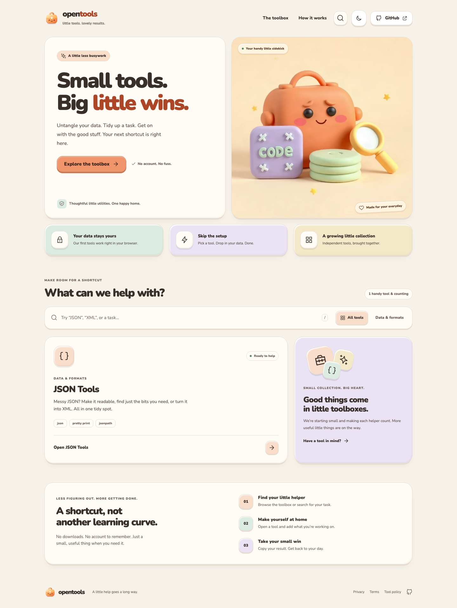
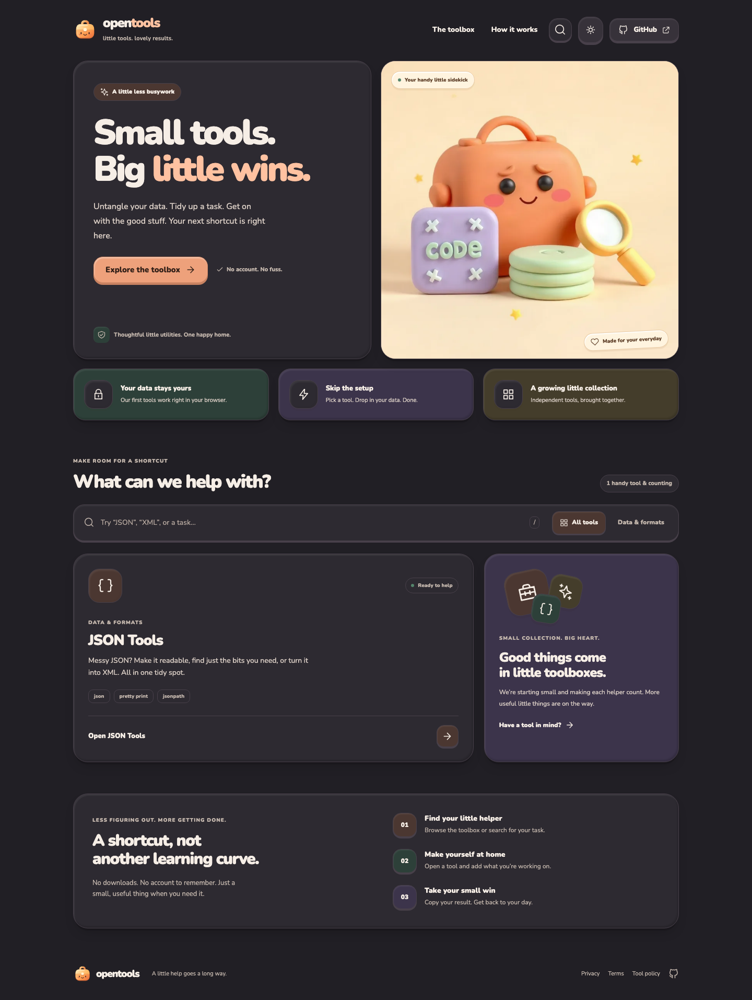

# Open Tools

A static SvelteKit aggregator for independent browser tools. Each registered tool is a **versioned bundle plus a manifest contract**, not an imported source repository. Tool repositories may be private; their released browser bundles and catalog metadata are public.

## Screenshots

Full-page desktop captures at 1440px wide from the production preview.

### Light mode



<details>
<summary>Dark mode</summary>



</details>

## Run

Requires Node.js 22+.

```sh
npm ci
npm run registry:sync
npm run dev
```

Open `/json-tools` for JSON formatting, JSONPath queries, JSON → XML and XML → JSON. The checked-in first bundle works offline without GitHub credentials. Its independently buildable source is mirrored in `examples/json-tools`; the standalone scaffold is published at `git@github.com-personal:ygrip/json-tools.git`, commit `73ccc3751785eb3203934535a223de89b788c31a`.

```sh
npm test
npm run check
npm run build
npm run performance:check
# Optional browser verification (after installing Chromium):
npx playwright install chromium
npm run test:e2e
```

`npm run build` syncs approved bundles before building the static site. The build output is `build/`; deploy it to any static host. It includes prerendered home/legal/tool routes as directory indexes and JSON-encoded bundle files. Directory indexes avoid depending on host-specific clean-URL rewrites. Deploy the complete output atomically, not just the catalog. `npm run dev` requires an initial sync; rerun sync and restart development after registry changes.

## Bundle contract v2

Every repository publishes `tool.manifest.json` and the referenced self-contained HTML in the **same Git commit**:

```json
{
  "schemaVersion": 2,
  "appearance": { "theme": "host", "protocolVersion": 1 },
  "id": "json-tools",
  "name": "JSON Tools",
  "description": "Format JSON, query with JSONPath, and convert JSON and XML.",
  "path": "/json-tools",
  "category": "data",
  "repository": "https://github.com/ygrip/json-tools",
  "version": "0.2.0",
  "status": "experimental",
  "capabilities": ["json", "jsonpath", "xml"],
  "bundle": {
    "format": "html",
    "file": "dist/index.html",
    "sha256": "<64 lowercase hex characters: SHA-256 of the exact HTML bytes>"
  }
}
```

Version 2 requires `appearance: { theme: "host", protocolVersion: 1 }`; legacy v1 manifests are rejected rather than registering a tool that ignores the host theme. To migrate, implement both theme styles, add the declaration, rebuild and update the pinned release.

See `examples/json-tools/tool.manifest.json` for a real manifest with a verified checksum. `src/lib/registry/contract.js` is the shared validation implementation used by the build and catalog.

1. Bundle all JavaScript, CSS and dependencies into one UTF-8 HTML file (maximum 5 MiB). No CDN imports, framework coupling, host callbacks, storage, clipboard permissions or runtime credentials.
2. Generate its SHA-256 and commit the HTML and manifest together. Source maps, server code, secrets and source checkout are not copied by Open Tools.
3. Register its repository and **full 40-character commit SHA** in `config/registry.json`. The owner must appear in `trustedOwners`; IDs/paths must be unique and cannot shadow host routes.

Allowed categories: `media`, `developer`, `data`, `productivity`, `other`. Status: `stable`, `beta`, `experimental`. IDs use lowercase letters/numbers separated by hyphens; paths must equal `/<id>`. Increment the tool version when releasing a new bundle, then explicitly update the pinned registration. No private package registry is required.

## Register a private repository

The local example keeps development credential-free. To load the actual standalone repository, use `config/registry.remote.example.json`, already pinned to the published scaffold, or replace the local source with an immutable remote source:

```json
{
  "trustedOwners": ["ygrip"],
  "topic": "open-tools",
  "discovery": false,
  "sources": [
    {
      "repository": "ygrip/json-tools",
      "ref": "<full 40-character commit SHA>"
    }
  ]
}
```

Set `TOOLS_GITHUB_TOKEN` in your build environment to a fine-grained PAT or GitHub App installation token with **Contents: read** access to each selected private repository. A host repository's default `GITHUB_TOKEN` usually cannot read other private repositories. The token is used only by the Node sync script through the authenticated GitHub API; it is not placed in generated metadata, bundle files, Svelte environment variables or browser code.

For different owners or repository-specific permissions, use `auth.owners` and `auth.repositories` with secret environment-variable names. Repository mappings take precedence over owner mappings, then the global token fallback. GitHub App installation credentials are also supported, with short-lived tokens, refresh and concurrent-request deduplication. Missing explicitly configured secrets fail closed rather than falling back to a broader token. See [multi-owner authentication](docs/registry-auth.md) and `config/registry.auth.example.json` for complete PAT/App and CI examples.

```sh
# Inject TOOLS_GITHUB_TOKEN through your secret manager or CI environment.
TOOLS_REGISTRY_CONFIG=config/registry.remote.example.json npm run registry:sync
TOOLS_REGISTRY_CONFIG=config/registry.remote.example.json npm run build
```

The sync reads only the manifest and HTML at the pinned commit, verifies identity, contract, checksum, UTF-8 and size, then publishes sanitized metadata and content-addressed `static/bundles/<id>/<sha256>.json`. It never installs dependencies or executes build scripts from a discovered repository. Authentication failures, invalid contracts and collisions fail the entire sync before replacing current output; they are not silently skipped.

`local: "examples/json-tools"` is an explicit offline scaffold source, constrained to `examples/` with symlink escape checks. Do not use it for private production source. Remote `ref` values cannot be branch names or tags.

## Discovery and approval

Explicit registrations are the default and recommended production approval mechanism. With `discovery: true`, the sync additionally searches trusted owners for the `open-tools` topic, resolves each default branch to a commit and applies the same contract/integrity checks. Private repositories are discoverable only when the build token can see them. Explicit sources take precedence. Discovery follows new releases on each sync, so enable it only if those repositories' maintainers are authorized to publish browser code to your site. A topic is not an independent security review.

`.github/workflows/registry.yml` verifies, builds and uploads the complete static site. Add `TOOLS_GITHUB_TOKEN` as an Actions secret for private sources; external-fork PRs cannot access it and therefore cannot validate private registrations. The workflow does not push generated commits or deploy automatically.

## Isolation and trust

Bundles are served as JSON, **never as executable same-origin HTML**. The loader embeds them using `srcdoc` in an opaque-origin `sandbox="allow-scripts"` iframe. Never add `allow-same-origin`. A host-prepended CSP restricts resource loads, connections, nested frames, workers, form submissions and base URLs. The parent document also restricts frame navigation to its own origin; Chromium regression tests verify external self-navigation is blocked. The bundle cannot access the parent's DOM, cookies or local storage, submit forms, open popups or navigate the top window.

This is defense in depth for **approved code**, not a complete hostile-code containment system. In particular, same-origin frame navigation remains possible and synchronous JavaScript can consume CPU. Review tools before registration; do not paste secrets into untrusted tools. Private source control does not make distributed JavaScript confidential: visitors can inspect the published HTML. The host exposes repository identity as provenance even when the repository is inaccessible to visitors.

## Host-controlled tool themes

Registered bundles must support both host themes. Open Tools sets `html[data-theme="light" | "dark"]` and `color-scheme` before tool scripts run. It supplies host-priority color tokens `--ot-bg`, `--ot-surface`, `--ot-text`, `--ot-muted`, `--ot-border`, `--ot-accent`, `--ot-on-accent`, `--ot-shadow` and `--ot-highlight`; the last two are colors, not whole shadow declarations. Style tool surfaces through these tokens and/or explicit `[data-theme]` rules. The host protects those token defaults with CSS priority. Do not override the host with an independent stored preference.

On a host theme change, Open Tools sends `{ type: "open-tools:theme", version: 1, theme: "light" | "dark" }` directly to its iframe. The host-owned receiver checks `event.source === parent` and validates every protocol field. It changes the root theme without reloading the frame or losing input/output. An opaque frame requires `targetOrigin: "*"`; this is a one-way theme-only channel, never a channel for user data. Sandbox permissions remain `allow-scripts` only.

The first tool release, JSON Tools v0.2.0, implements this contract and has browser regressions for both modes, persistence, denied storage, and input/output preservation. Custom bundle markup still needs visual review: declaring a theme cannot make an arbitrary hardcoded design compliant automatically. Do not register a tool that ignores the host theme.

## First bundle development

```sh
cd examples/json-tools
npm ci
npm test
npm run build
cd ../..
npm run registry:sync
```

The initial scaffold has been pushed to the standalone repository. For subsequent releases, publish the changed source, lockfile, manifest and HTML together there (excluding `node_modules`), then update the aggregator's pinned ref. See its README for supported JSONPath selectors, XML mapping conventions and limitations.

## Illustrated global errors

The shared `+error.svelte` handles missing routes and unexpected navigation/render failures, with dedicated clay illustrations and friendly 401/403/404/429/500/503 copy. Client and server hooks return safe messages; unexpected server failures carry a reference ID. Diagnostics intentionally omit raw exception messages, stacks, request paths and credential-bearing objects. Expected 4xx states do not create incident logs. The server hook preserves error status/body and marks HTTP error responses `Cache-Control: no-store`.

`src/error.html` is an independent, JavaScript-free fallback for failures before Svelte can render. Its illustration is inline SVG, so it does not depend on fonts, images, chunks or the application layout. The build also exports `build/500.html` and `build/503.html`, each labeled with its matching status. Configure your static host/CDN to serve the matching file for HTTP 500 or 503, preserve the original error status (never redirect to HTTP 200), and set `Cache-Control: no-store` on error responses; a static application cannot set a CDN's upstream status, cache headers or error mapping itself. Keep the adapter's `404.html` fallback for unknown routes. The static fallback follows the system light/dark preference without needing browser storage.

## Clay workbench design and performance

The responsive shell uses warm cream/coral clay surfaces, rounded bento cards, mint/lavender details, tactile buttons, a self-hosted subsetted Nunito variable font and a cartoon toolbox mascot. Dark mode uses warm charcoal surfaces rather than an inverted light palette. The SVG logo/favicon are original artwork; the optimized responsive hero illustration was generated with Fal.ai. Asset provenance lives in `static/brand/README.md` and `static/illustrations/README.md`. No Fal credential or request is used by the website.

Quick search is loaded only on first use, with a native modal focus trap, Escape dismissal and focus restoration. The homepage no longer loads or runs the animated canvas dot field. The hero reserves its dimensions, loads eagerly with responsive WebP variants and high fetch priority, and weighs 7.2/14.8 kB. Font preload and `font-display: optional` avoid avoidable font shifts. Motion uses explicit properties and respects reduced-motion preferences.

The requested skills are installed in project scope under `.agents/skills`: `transitions-dev` from the official `Jakubantalik/transitions.dev` repository and `web-performance` from skills.ws. Modal/icon motion uses the free Transitions.dev recipes; its license is included with the installed skill. Reinstall with:

```sh
npx skills add Jakubantalik/transitions.dev --skill transitions-dev --agent codex --copy --yes
npx skills-ws install web-performance --dir .agents/skills
```

`npm run performance:check` enforces build budgets across all routes: 130 kB gzip JavaScript, 20 kB gzip CSS, 90 kB images, 45 kB WOFF2 fonts and 90 kB gzip per tool bundle. CI also runs browser checks for tool isolation, theme synchronization, search/focus, mobile overflow, reduced motion and automated WCAG A/AA checks in light/dark mode. A local production-preview audit with Lighthouse 13.5.0 and simulated mobile throttling scored **99 performance / 100 accessibility / 100 best practices**, with LCP 2.0 s, CLS 0 and TBT 0 ms. Build budgets and local lab scores are not production Core Web Vitals; field p75 LCP/INP/CLS still require real traffic measurements.
