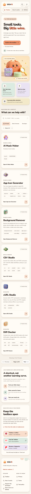
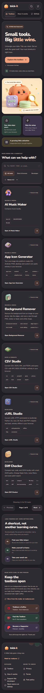
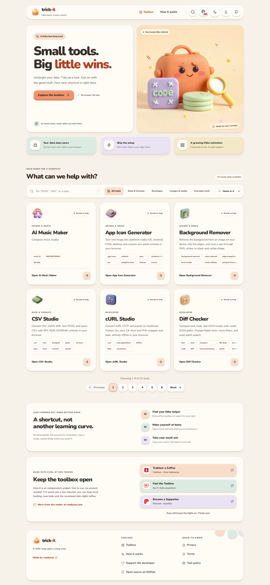
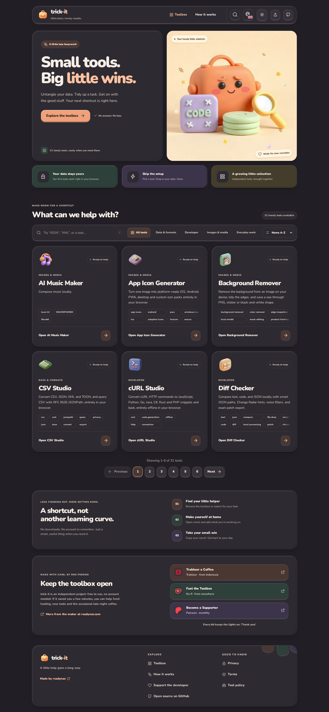

# trick-it

A localized, installable SvelteKit platform for independent browser tools. Each tool has a **versioned HTML entry bundle plus a validated manifest**, not imported source code. Optional deferred assets are fetched by the host only after consent and integrity checks. Source repositories may be private; shipped code and metadata are public. The GitHub repository is [`ygrip/trick-it`](https://github.com/ygrip/trick-it) (formerly `ygrip/open-tools`).

English and Indonesian pages are prerendered and support SPA navigation, per-tool guides/SEO, explicit capabilities, verified model/WASM downloads, and PWA offline access. Start with [localization](docs/i18n.md), [v3 metadata](docs/tool-contract-v3.md), [permissions/runtime](docs/tool-runtime.md), [PWA](docs/pwa.md), or [SEO deployment](docs/seo.md).

## Live production screenshots

These captures come from the **deployed** [tools.readynaz.com](https://tools.readynaz.com/) homepage, rather than a locally rendered preview. Each screenshot is full-page. The automated Chromium capture uses a consistent viewport, explicit light/dark preferences, English locale, and reduced motion so the documentation is reproducible.

| Mobile (390 × 844 viewport) | |
| :---: | :---: |
| **Light** | **Dark** |
|  |  |

<details>
<summary>Desktop, light theme (1440 × 900 viewport)</summary>



</details>

<details>
<summary>Desktop, dark theme (1440 × 900 viewport)</summary>



</details>

Screenshot provenance, actual pixel sizes, capture time, HTTP status, and layout diagnostics are recorded in [capture.json](docs/screenshots/live/capture.json). Refresh instructions are in [the screenshot guide](docs/live-screenshots.md). Earlier screenshots are retained under `docs/screenshots/` for historical comparison.

## Run

Requires Node.js 22+.

```sh
npm ci
npm run registry:sync
npm run dev
```

Open `/json-tools` for JSON formatting, JSONPath queries, JSON → XML and XML → JSON. Version 0.3.0 is built and released from the separate private `ygrip/json-tools` repository, with the tool's own HTML and manifest pinned to an immutable source commit. The trick-it host no longer carries a duplicate source or bundle.

`/text-manipulation/` is the second tool, offering case conversions, line deduplication and sorting, whitespace cleanup, literal find/replace, Unicode-friendly slugs, and text statistics. It is pinned to an immutable commit in the private [`ygrip/text-manipulation`](https://github.com/ygrip/text-manipulation) repository. **Local and CI builds must supply `TOOLS_GITHUB_TOKEN` with read-only access to that repository.** JSON Tools is also a private remote source: CI and local builds need `TOOLS_GITHUB_TOKEN` with Contents: read on both repositories.

```sh
npm test
npm run check
npm run build
npm run performance:check
# Optional browser verification (after installing Chromium):
npx playwright install chromium
npm run test:e2e
```

Tool-specific functional and UI/browser tests belong in each tool repository, not in this host's test suite. The [shared runtime harness](tests/tool-harness/README.md) lets those suites exercise the real host/SDK against their own local artifact without a registry re-pin. Host tests cover the shared runtime, permissions/security, catalog and site behavior; see [test ownership](docs/tool-ui-checklist.md#test-ownership).

`npm run build` syncs approved bundles before building the static site. The build output is `build/`; deploy it to any static host. It includes prerendered home/legal/tool routes as directory indexes and JSON-encoded bundle files. Directory indexes avoid depending on host-specific clean-URL rewrites. Deploy the complete output atomically, not just the catalog. `npm run dev` requires an initial sync; rerun sync and restart development after registry changes.

## Optional advertising

Host advertising is off by default. Configure `config/ads.json` for manual home/tool AdSense slots, test mode, and explicit host frame origins. A default-denied consent bridge must be connected to your CMP before any SDK or ad request is made. Tool iframes do not receive ad code or additional permissions. See [advertising setup, consent, and privacy disclosures](docs/advertising.md) before enabling it.

## Bundle contract v3 (with legacy v2 compatibility)

Every repository publishes `tool.manifest.json` and the referenced self-contained HTML in the **same Git commit**:

```json
{
  "schemaVersion": 3,
  "runtimeVersion": 1,
  "appearance": { "theme": "host", "protocolVersion": 1 },
  "icon": "braces",
  "seo": { "title": "JSON Tools", "description": "Format, query and convert JSON locally.", "keywords": ["json", "xml"], "robots": "index" },
  "guide": { "summary": "Process data locally.", "steps": ["Choose an operation.", "Paste input and run.", "Select the result to copy it."] },
  "permissions": [],
  "assets": [],
  "translations": {},
  "id": "json-tools",
  "name": "JSON Tools",
  "description": "Format JSON, query with JSONPath, and convert JSON and XML.",
  "path": "/json-tools",
  "category": "data",
  "repository": "https://github.com/ygrip/json-tools",
  "version": "0.3.0",
  "status": "experimental",
  "capabilities": ["json", "jsonpath", "xml"],
  "bundle": {
    "format": "html",
    "file": "dist/index.html",
    "sha256": "<64 lowercase hex characters: SHA-256 of the exact HTML bytes>"
  }
}
```

New tools use v3 with runtime protocol 1. Legacy v2 manifests still receive safe icon/SEO/guide defaults and no privileges; they cannot opt into permissions or external assets without migrating. Both versions require the host theme declaration; v1 remains rejected. For v3 assets, explicitly approve HTTPS origins in `trustedAssetOrigins`; declare byte size, digest, type and deferred loading. See [complete limits and migration](docs/tool-contract-v3.md).

See the independently versioned [JSON Tools manifest](https://github.com/ygrip/json-tools/blob/main/tool.manifest.json) for a real manifest with a verified checksum. `src/lib/registry/contract.js` is the shared validation implementation used by the build and catalog.

To create a different tool, follow [Scaffold and register a tool](docs/scaffold-tool.md). New and updated tools must use the provided UI for applicable file inputs, job/asset loading, toasts and popups; complete the [shared-UI release gate](docs/tool-ui-checklist.md) and migrate nonconforming controls before pushing. It includes copyable HTML, a dependency-free builder, a v3 manifest, a checksum smoke test, optional local scaffolding, and private-repository publishing. The project-local agent skill lives at `.agents/skills/trick-it-scaffold/SKILL.md`; ask your agent to “scaffold and register a trick-it tool.”

1. Bundle the entry application into one UTF-8 HTML file (maximum 5 MiB). Additional public code/models/data must use the declared, approved, consented asset loader—not direct iframe network access. Sensitive browser actions go through the host broker; never include runtime credentials or add `allow-same-origin`.
2. Generate its SHA-256 and commit the HTML and manifest together. Source maps, server code, secrets and source checkout are not copied by trick-it.
3. Register its repository and **full 40-character commit SHA** in its own `config/tools/<id>.json` file. The owner must appear in `trustedOwners`; IDs/paths must be unique and cannot shadow host routes.

Allowed categories: `media`, `developer`, `data`, `productivity`, `other`. Status: `stable`, `beta`, `experimental`. IDs use lowercase letters/numbers separated by hyphens; paths must equal `/<id>`. Increment the tool version when releasing a new bundle, then explicitly update the pinned registration. No private package registry is required.


See [protected Worker-backed features](docs/protected-services.md) to configure per-tool request limits and Turnstile in the manifest. Local tools remain permission-free.

## Per-tool marketplace registrations

**New production tools do not belong in `examples/`.** Each standalone tool repository owns its HTML, manifest, tests and release documentation. Register an immutable source through one small file in `config/tools/` (for example `id-generator.json`), rather than editing the shared `config/registry.json` sources array:

```json
{ "repository": "ygrip/id-generator", "ref": "633e6b044a21493dec72f5741f447b0e0ba60d6d" }
```

The shared config now only holds platform trust/discovery settings and `toolDirectory`. JSON Tools v0.3 is published in its standalone repository and pinned as a remote source, like the other production tools. For private tool sources, set `TOOLS_GITHUB_TOKEN` with read-only Contents permission. See [per-tool registry and migration](docs/registry-layout.md).

## Register a private repository

A private tool is registered by its own `config/tools/<id>.json`, pinned to a release commit. Legacy alternate registry files such as `config/registry.remote.example.json` still support a `sources` array for compatibility:

```json
{
  "trustedOwners": ["ygrip"],
  "topic": "open-tools",
  "discovery": false,
  "sources": [
    {
      "repository": "ygrip/json-tools",
      "ref": "<full 40-character commit SHA>"
    }
  ]
}
```

Set `TOOLS_GITHUB_TOKEN` in your build environment to a fine-grained PAT or GitHub App installation token with **Contents: read** access to each selected private repository. A host repository's default `GITHUB_TOKEN` usually cannot read other private repositories. The token is used only by the Node sync script through the authenticated GitHub API; it is not placed in generated metadata, bundle files, Svelte environment variables or browser code.

For different owners or repository-specific permissions, use `auth.owners` and `auth.repositories` with secret environment-variable names. Repository mappings take precedence over owner mappings, then the global token fallback. GitHub App installation credentials are also supported, with short-lived tokens, refresh and concurrent-request deduplication. Missing explicitly configured secrets fail closed rather than falling back to a broader token. See [multi-owner authentication](docs/registry-auth.md) and `config/registry.auth.example.json` for complete PAT/App and CI examples.

```sh
# Inject TOOLS_GITHUB_TOKEN through your secret manager or CI environment.
TOOLS_REGISTRY_CONFIG=config/registry.remote.example.json npm run registry:sync
TOOLS_REGISTRY_CONFIG=config/registry.remote.example.json npm run build
```

The sync reads only the manifest and HTML at the pinned commit, verifies identity, contract, checksum, UTF-8 and size, then publishes sanitized metadata and content-addressed `static/bundles/<id>/<sha256>.json`. It never installs dependencies or executes build scripts from a discovered repository. Authentication failures, invalid contracts and collisions fail the entire sync before replacing current output; they are not silently skipped.

Local development fixtures may still live in `examples/`, with symlink escape checks. No production tool uses this mode; every production entry resolves a standalone repository. Remote `ref` values cannot be branch names or tags.

## Discovery and approval

Explicit registrations are the default and recommended production approval mechanism. With `discovery: true`, the sync additionally searches trusted owners for the `open-tools` topic, resolves each default branch to a commit and applies the same contract/integrity checks. Private repositories are discoverable only when the build token can see them. Explicit sources take precedence. Discovery follows new releases on each sync, so enable it only if those repositories' maintainers are authorized to publish browser code to your site. A topic is not an independent security review.

`.github/workflows/registry.yml` verifies, builds and uploads the complete static site. Add `TOOLS_GITHUB_TOKEN` as an Actions secret for private sources; external-fork PRs cannot access it and therefore cannot validate private registrations. The workflow does not push generated commits and deploys only for verified pushes to main, not pull requests.

## Isolation and trust

Bundles are served as JSON, **never as executable same-origin HTML**. The loader embeds them using `srcdoc` in an opaque-origin `sandbox="allow-scripts"` iframe. Never add `allow-same-origin`. A host-prepended CSP restricts resource loads, connections, nested frames, workers, form submissions and base URLs. The parent document also restricts frame destinations; Chromium regression tests verify unapproved external self-navigation is blocked. Optional host advertising extends this document-wide allowlist to explicitly configured provider origins, an additional trust choice described in [advertising setup](docs/advertising.md). The bundle cannot access the parent's DOM, cookies or local storage, submit forms, open popups or navigate the top window.

This is defense in depth for **approved code**, not a complete hostile-code containment system. In particular, same-origin frame navigation remains possible and synchronous JavaScript can consume CPU. Review tools before registration; do not paste secrets into untrusted tools. Private source control does not make distributed JavaScript confidential: visitors can inspect the published HTML. The host exposes repository identity as provenance even when the repository is inaccessible to visitors.

## Host-controlled tool themes

Registered bundles must support both host themes. trick-it sets `html[data-theme="light" | "dark"]` and `color-scheme` before tool scripts run. It supplies host-priority color tokens `--ot-bg`, `--ot-surface`, `--ot-text`, `--ot-muted`, `--ot-border`, `--ot-accent`, `--ot-on-accent`, `--ot-shadow` and `--ot-highlight`; the last two are colors, not whole shadow declarations. Style tool surfaces through these tokens and/or explicit `[data-theme]` rules. The host protects those token defaults with CSS priority. Do not override the host with an independent stored preference.

On a host theme change, trick-it sends `{ type: "open-tools:theme", version: 1, theme: "light" | "dark" }` directly to its iframe. The host-owned receiver checks `event.source === parent` and validates every protocol field. It changes the root theme without reloading the frame or losing input/output. An opaque frame requires `targetOrigin: "*"`; this legacy theme channel never carries user data. The separate v3 capability channel validates frame source, random session token, request ID and declared/granted permission before acting; sensitive operations require a host confirmation. Sandbox flags remain `allow-scripts` only, while WebAssembly and blob workers are conditional CSP grants.

JSON Tools v0.3.0 implements this contract and has browser regressions for both modes, persistence, denied storage, and input/output preservation. Custom bundle markup still needs visual review: declaring a theme cannot make an arbitrary hardcoded design compliant automatically. Do not register a tool that ignores the host theme.

## First bundle development

```sh
git clone git@github.com:ygrip/json-tools.git
cd json-tools
npm ci
npm test
npm run build
cd ../..
npm run registry:sync
```

The standalone JSON Tools repository owns its source and release HTML. For subsequent releases, publish the changed source, lockfile, manifest and HTML together there (excluding `node_modules`), then update the aggregator's pinned ref. See its README for supported JSONPath selectors, XML mapping conventions and limitations.

## Illustrated global errors

The shared `+error.svelte` handles missing routes and unexpected navigation/render failures, with dedicated clay illustrations and friendly 401/403/404/429/500/503 copy. Client and server hooks return safe messages; unexpected server failures carry a reference ID. Diagnostics intentionally omit raw exception messages, stacks, request paths and credential-bearing objects. Expected 4xx states do not create incident logs. The server hook preserves error status/body and marks HTTP error responses `Cache-Control: no-store`.

`src/error.html` is an independent, JavaScript-free fallback for failures before Svelte can render. Its illustration is inline SVG, so it does not depend on fonts, images, chunks or the application layout. The build also exports `build/500.html` and `build/503.html`, each labeled with its matching status. Configure your static host/CDN to serve the matching file for HTTP 500 or 503, preserve the original error status (never redirect to HTTP 200), and set `Cache-Control: no-store` on error responses; a static application cannot set a CDN's upstream status, cache headers or error mapping itself. Keep the adapter's `404.html` fallback for unknown routes. The static fallback follows the system light/dark preference without needing browser storage.

## Clay workbench design and performance

The responsive shell uses warm cream/coral clay surfaces, rounded bento cards, mint/lavender details, tactile buttons, a self-hosted subsetted Nunito variable font and a cartoon toolbox mascot. Dark mode uses warm charcoal surfaces rather than an inverted light palette. The SVG logo/favicon are original artwork; the optimized responsive hero illustration was generated with Fal.ai. Asset provenance lives in `static/brand/README.md` and `static/illustrations/README.md`. No Fal credential or request is used by the website.

Quick search is loaded only on first use, with a native modal focus trap, Escape dismissal and focus restoration. The homepage no longer loads or runs the animated canvas dot field. The hero reserves its dimensions, loads eagerly with responsive WebP variants and high fetch priority, and weighs 7.2/14.8 kB. Font preload and `font-display: optional` avoid avoidable font shifts. Motion uses explicit properties and respects reduced-motion preferences. The hero combines a native CSS border orbit, gentle float and sparkles, inspired by [Libraries.dev Border beam](https://libraries.dev/beam.html). It adds no React, canvas, WebGL or animation runtime. The pause/play control stops all hero motion; animations also pause offscreen or in a hidden tab and are disabled for reduced motion.

The mobile header keeps search/theme controls and a separate 44px-target navigation row visible down to 320px. The tool catalog renders six results per page, with numbered desktop controls and compact previous/next controls on mobile. Search/category changes reset to page one; paging focuses the catalog heading. The catalog may span multiple pages as more standalone tools are registered. Browser tests mount the actual homepage with 14 test-only entries to exercise multiple pages without publishing fake tools.

The requested skills are installed in project scope under `.agents/skills`: `transitions-dev` from the official `Jakubantalik/transitions.dev` repository and `web-performance` from skills.ws. Modal/icon motion uses the free Transitions.dev recipes; its license is included with the installed skill. Reinstall with:

```sh
npx skills add Jakubantalik/transitions.dev --skill transitions-dev --agent codex --copy --yes
npx skills-ws install web-performance --dir .agents/skills
```

`npm run performance:check` enforces build budgets across all routes: 130 kB gzip JavaScript, 20 kB gzip CSS, 90 kB images, 45 kB WOFF2 fonts and 90 kB gzip per tool bundle. CI also runs browser checks for tool isolation, theme synchronization, search/focus, mobile overflow, reduced motion and automated WCAG A/AA checks in light/dark mode. A local production-preview audit with Lighthouse 13.5.0 and simulated mobile throttling scored **99 performance / 100 accessibility / 100 best practices**, with LCP 2.1 s, CLS 0 and TBT 0 ms. Build budgets and local lab scores are not production Core Web Vitals; field p75 LCP/INP/CLS still require real traffic measurements.
